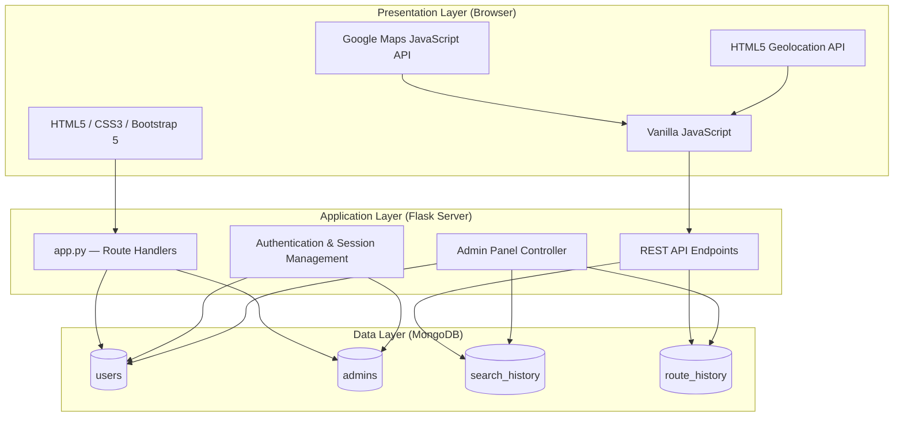
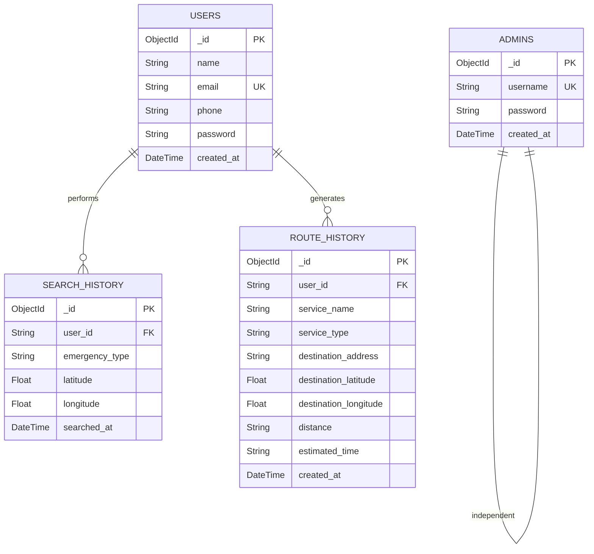
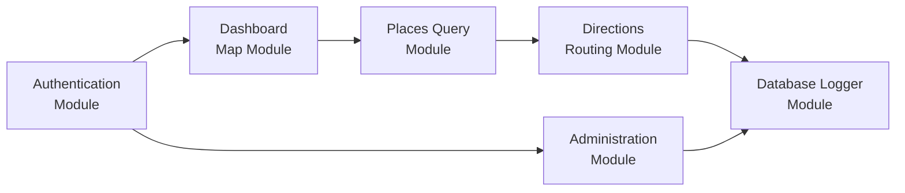
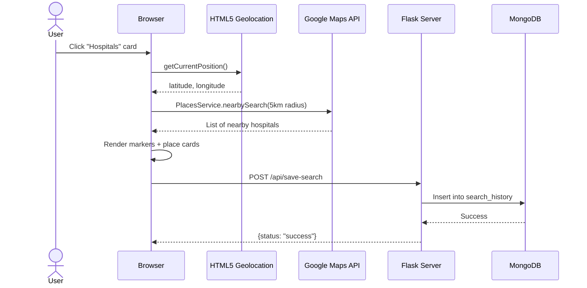
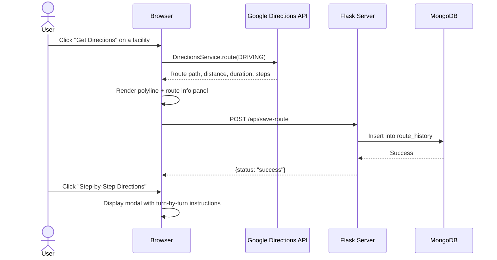

# Emergency Route System — Implementation Details

> A web-based emergency service routing application built with **Python Flask**, **MongoDB**, and **Google Maps API** that detects user location via GPS, finds nearby hospitals, police stations, and fire stations within a 5 km radius, and plots the shortest driving route with distance and duration metrics.

---

## 1. System Architecture

The application follows a **3-Tier Architecture**:



| Layer | Technology | Responsibility |
|-------|-----------|----------------|
| **Presentation** | HTML5, CSS3, Bootstrap 5, Font Awesome 6, Vanilla JS, Google Maps API | User interface, map rendering, geolocation, AJAX calls |
| **Application** | Python Flask, Werkzeug | Routing, authentication, session management, REST API, admin panel |
| **Data** | MongoDB (via PyMongo) | Document storage for users, admins, search logs, route logs |

---

## 2. Technology Stack

### 2.1 Backend

| Technology | Version | Purpose |
|-----------|---------|---------|
| Python | 3.8+ | Core programming language |
| Flask | 3.0.3 | WSGI web application framework |
| Werkzeug | 3.0.3 | HTTP utilities & PBKDF2 SHA-256 password hashing |
| PyMongo | 4.7.2 | Official MongoDB Python driver |
| dnspython | 2.6.1 | DNS SRV record resolution for `mongodb+srv://` URIs |
| python-dotenv | 1.0.1 | Environment variable management from `.env` files |

### 2.2 Frontend

| Technology | Purpose |
|-----------|---------|
| HTML5 | Semantic page structure |
| CSS3 + Bootstrap 5 | Responsive layout, component styling, grid system |
| Font Awesome 6 | Icon library for UI elements |
| Bootstrap Icons | Supplementary icon set |
| Google Fonts (Inter, Outfit) | Custom typography |
| Vanilla JavaScript | DOM manipulation, AJAX, map interaction logic |

### 2.3 External APIs

| API | Purpose |
|-----|---------|
| Google Maps JavaScript API | Interactive map rendering and viewport control |
| Google Places API | Nearby emergency facility search within 5 km radius |
| Google Directions API | Driving route calculation with distance & duration |
| HTML5 Geolocation API | Browser-based GPS coordinate detection |

---

## 3. Project Directory Structure

```
emergency-route-system/
├── .env                          # Environment variables (SECRET_KEY, MONGO_URI, API_KEY)
├── .env.example                  # Template for environment variables
├── .gitignore                    # Git ignore rules
├── README.md                     # Project documentation & setup guide
├── app.py                        # Main Flask application (routes, models, API)
├── college_documentation.md      # Academic project documentation
├── config.py                     # Configuration class with env loading
├── requirements.txt              # Python package dependencies
│
├── database/                     # (Reserved for database exports/seeds)
│
├── scripts/
│   ├── create_admin.py           # Interactive CLI admin account creator
│   └── seed_admin.py             # Automated default admin seeder
│
├── static/
│   ├── css/
│   │   └── style.css             # Custom design system stylesheet
│   └── js/
│       ├── main.js               # Global alert handling utilities
│       └── maps.js               # Google Maps integration & routing logic
│
├── templates/
│   ├── base.html                 # Master layout template (head, nav, footer)
│   ├── navbar.html               # Responsive navigation bar (included in base)
│   ├── index.html                # Public landing page / homepage
│   ├── about.html                # Project information & tech stack
│   ├── contact.html              # Contact form & support info
│   ├── login.html                # User login page
│   ├── register.html             # User registration page
│   ├── dashboard.html            # Interactive map dashboard (core feature)
│   ├── profile.html              # User profile management
│   ├── search_history.html       # User's emergency search logs
│   ├── route_history.html        # User's calculated route logs
│   ├── db_error.html             # Database connection error fallback
│   │
│   └── admin/
│       ├── login.html            # Admin authentication page
│       ├── dashboard.html        # Admin system metrics & overview
│       ├── users.html            # User account management (CRUD)
│       ├── search_history.html   # Global search log auditing with filters
│       └── route_history.html    # Global route log auditing
│
└── venv/                         # Python virtual environment
```

---

## 4. Configuration Management

### 4.1 Environment Variables (`.env`)

| Variable | Description | Default |
|----------|-------------|---------|
| `SECRET_KEY` | Flask session signing key for cookie integrity | `default-development-secret-key-12345` |
| `MONGO_URI` | MongoDB connection URI (local or Atlas cloud) | `mongodb://localhost:27017/emergency_route_system` |
| `GOOGLE_MAPS_API_KEY` | Google Cloud API key for Maps/Places/Directions | `''` (empty) |

### 4.2 Config Class ([config.py](file:///c:/Users/rashm/OneDrive/Desktop/emergency-route-system/config.py))

```python
class Config:
    SECRET_KEY = os.environ.get('SECRET_KEY', 'default-development-secret-key-12345')
    MONGO_URI = os.environ.get('MONGO_URI', 'mongodb://localhost:27017/emergency_route_system')
    GOOGLE_MAPS_API_KEY = os.environ.get('GOOGLE_MAPS_API_KEY', '')
    SESSION_COOKIE_HTTPONLY = True   # Prevent JS access to session cookie
    SESSION_COOKIE_SECURE = False    # Set True in production (HTTPS only)
```

---

## 5. Database Design (MongoDB)

### 5.1 Collection Schemas

#### `users` Collection

| Field | Type | Description |
|-------|------|-------------|
| `_id` | `ObjectId` | Auto-generated primary key |
| `name` | `String` | User full name |
| `email` | `String` | Unique email address (used for login) |
| `phone` | `String` | Contact phone number |
| `password` | `String` | Werkzeug PBKDF2 SHA-256 hashed password |
| `created_at` | `DateTime` | UTC registration timestamp |

#### `admins` Collection

| Field | Type | Description |
|-------|------|-------------|
| `_id` | `ObjectId` | Auto-generated primary key |
| `username` | `String` | Unique admin username |
| `password` | `String` | Werkzeug PBKDF2 SHA-256 hashed password |
| `created_at` | `DateTime` | UTC creation timestamp |

#### `search_history` Collection

| Field | Type | Description |
|-------|------|-------------|
| `_id` | `ObjectId` | Auto-generated primary key |
| `user_id` | `String` | Reference to `users._id` (as string) |
| `emergency_type` | `String` | Category: `Hospital`, `Police`, or `Fire` |
| `latitude` | `Float` | Search origin latitude |
| `longitude` | `Float` | Search origin longitude |
| `searched_at` | `DateTime` | UTC search timestamp |

#### `route_history` Collection

| Field | Type | Description |
|-------|------|-------------|
| `_id` | `ObjectId` | Auto-generated primary key |
| `user_id` | `String` | Reference to `users._id` (as string) |
| `service_name` | `String` | Target facility name |
| `service_type` | `String` | Emergency service category |
| `destination_address` | `String` | Facility street address |
| `destination_latitude` | `Float` | Destination latitude |
| `destination_longitude` | `Float` | Destination longitude |
| `distance` | `String` | Driving distance (e.g., "2.3 km") |
| `estimated_time` | `String` | Estimated travel time (e.g., "8 mins") |
| `created_at` | `DateTime` | UTC route calculation timestamp |

### 5.2 Entity Relationships



> [!IMPORTANT]
> **Cascading Deletion**: When an admin deletes a user, the application programmatically executes `delete_many({"user_id": user_id})` on both `search_history` and `route_history` collections to remove all associated records.

---

## 6. Application Modules

### 6.1 Module Overview



| # | Module | Description | Key Files |
|---|--------|-------------|-----------|
| 1 | **Authentication** | User registration, login, logout, session management | `app.py`, `login.html`, `register.html` |
| 2 | **Dashboard Map** | Interactive Google Maps interface with geolocation | `dashboard.html`, `maps.js` |
| 3 | **Places Query** | Nearby emergency facility search (5 km radius) | `maps.js` (`searchPlaces()`) |
| 4 | **Directions Routing** | Driving route calculation with step-by-step directions | `maps.js` (`getDirections()`) |
| 5 | **Database Logger** | AJAX API endpoints for persisting search & route logs | `app.py` (`/api/save-search`, `/api/save-route`) |
| 6 | **Administration** | Admin dashboard, user management, log auditing | `app.py` (admin routes), `admin/*.html` |

---

## 7. Backend Implementation ([app.py](file:///c:/Users/rashm/OneDrive/Desktop/emergency-route-system/app.py))

### 7.1 Database Connection Management

| Function | Decorator | Description |
|----------|-----------|-------------|
| `get_db()` | — | Opens per-request MongoDB connection via `pymongo.MongoClient` with 5s timeout. Validates connectivity with `server_info()`. |
| `close_db(error)` | `@app.teardown_appcontext` | Safely closes MongoDB connection at end of request lifecycle. |
| `handle_database_error(error)` | `@app.errorhandler(PyMongoError)` | Global error handler rendering `db_error.html` with HTTP 500 status. |

### 7.2 Authentication Decorators

```python
@login_required      # Checks session['user_id'], redirects to /login if absent
@admin_required      # Checks session['admin_id'], redirects to /admin/login if absent
```

### 7.3 Route Map — All Endpoints

#### Public Routes

| Route | Method | Handler | Template | Description |
|-------|--------|---------|----------|-------------|
| `/` | `GET` | `home()` | `index.html` | Landing page with hero banner and service cards |
| `/about` | `GET` | `about()` | `about.html` | Project information and tech stack |
| `/contact` | `GET, POST` | `contact()` | `contact.html` | Contact form with validation and flash messages |

#### User Authentication Routes

| Route | Method | Handler | Template | Description |
|-------|--------|---------|----------|-------------|
| `/register` | `GET, POST` | `register()` | `register.html` | Account creation with email uniqueness check, regex validation, and password hashing |
| `/login` | `GET, POST` | `login()` | `login.html` | Email/password authentication, session creation |
| `/logout` | `GET` | `logout()` | — | Clears session keys, redirects to `/login` |

#### User Panel Routes (Protected: `@login_required`)

| Route | Method | Handler | Template | Description |
|-------|--------|---------|----------|-------------|
| `/dashboard` | `GET` | `dashboard()` | `dashboard.html` | Interactive map with Google Maps API key injection |
| `/profile` | `GET, POST` | `profile()` | `profile.html` | View/update name, phone, password |
| `/search-history` | `GET` | `search_history()` | `search_history.html` | User's emergency search logs (sorted by date desc) |
| `/route-history` | `GET` | `route_history()` | `route_history.html` | User's calculated route logs (sorted by date desc) |

#### REST API Endpoints (Protected: `@login_required`)

| Route | Method | Handler | Request Body | Response |
|-------|--------|---------|-------------|----------|
| `/api/save-search` | `POST` | `save_search()` | `{ emergency_type, latitude, longitude }` | `{ status, message }` — 200/400/500 |
| `/api/save-route` | `POST` | `save_route()` | `{ service_name, service_type, destination_address, destination_latitude, destination_longitude, distance, estimated_time }` | `{ status, message }` — 200/400/500 |

#### Admin Panel Routes (Protected: `@admin_required` except login)

| Route | Method | Handler | Template | Description |
|-------|--------|---------|----------|-------------|
| `/admin/login` | `GET, POST` | `admin_login()` | `admin/login.html` | Admin credential verification |
| `/admin/dashboard` | `GET` | `admin_dashboard()` | `admin/dashboard.html` | System metrics (total users, searches by category, routes) |
| `/admin/users` | `GET` | `admin_users()` | `admin/users.html` | List all registered users |
| `/admin/users/delete/<user_id>` | `POST` | `delete_user()` | — | Delete user with cascading log cleanup |
| `/admin/search-history` | `GET` | `admin_search_history()` | `admin/search_history.html` | Global search logs with type/date filters |
| `/admin/route-history` | `GET` | `admin_route_history()` | `admin/route_history.html` | Global route logs with user details joined |
| `/admin/logout` | `GET` | `admin_logout()` | — | Clear admin session, redirect to admin login |

### 7.4 Business Logic Details

#### User Registration Flow
1. Validate all fields are non-empty
2. Validate email format via regex: `[^@]+@[^@]+\.[^@]+`
3. Validate password matches confirm_password
4. Check email uniqueness in `db.users` via `find_one()`
5. Hash password using `werkzeug.security.generate_password_hash()`
6. Insert user document with `created_at: datetime.utcnow()`
7. Flash success message and redirect to `/login`

#### User Login Flow
1. Query `db.users` by email
2. Validate password hash using `check_password_hash()`
3. Set session keys: `user_id`, `user_name`, `user_email`
4. Redirect to `/dashboard`

#### Admin Dashboard Metrics Calculation
```python
stats = {
    'total_users':      db.users.count_documents({}),
    'total_searches':   db.search_history.count_documents({}),
    'hospital_searches': db.search_history.count_documents({'emergency_type': 'Hospital'}),
    'police_searches':  db.search_history.count_documents({'emergency_type': 'Police'}),
    'fire_searches':    db.search_history.count_documents({'emergency_type': 'Fire'}),
    'total_routes':     db.route_history.count_documents({})
}
```

#### Admin Search Log Filtering
- Filters by `emergency_type` via query parameter `?type=`
- Filters by date range via `?date=YYYY-MM-DD` converted to `$gte` / `$lte` datetime range
- Joins user details (`name`, `email`) from `db.users` via `user_id` lookup

---

## 8. Frontend Implementation

### 8.1 Template Hierarchy

```mermaid
graph TD
    BASE["base.html<br/>(Master Layout)"]
    NAV["navbar.html<br/>(Navigation Bar)"]

    BASE -->|includes| NAV
    BASE -->|extends| INDEX["index.html"]
    BASE -->|extends| ABOUT["about.html"]
    BASE -->|extends| CONTACT["contact.html"]
    BASE -->|extends| LOGIN["login.html"]
    BASE -->|extends| REGISTER["register.html"]
    BASE -->|extends| DASH["dashboard.html"]
    BASE -->|extends| PROFILE["profile.html"]
    BASE -->|extends| SH["search_history.html"]
    BASE -->|extends| RH["route_history.html"]
    BASE -->|extends| AL["admin/login.html"]
    BASE -->|extends| AD["admin/dashboard.html"]
    BASE -->|extends| AU["admin/users.html"]
    BASE -->|extends| ASH["admin/search_history.html"]
    BASE -->|extends| ARH["admin/route_history.html"]

    DBERR["db_error.html<br/>(Standalone)"]
```



### 8.2 Base Template ([base.html](file:///c:/Users/rashm/OneDrive/Desktop/emergency-route-system/templates/base.html))

- **Head**: Loads Google Fonts (Inter & Outfit), Bootstrap 5 CSS, Bootstrap Icons, Font Awesome 6, custom `style.css`
- **Body**: Flex column layout (`min-vh-100`), includes `navbar.html`, renders Flask flash messages with contextual icons
- **Footer**: Dark themed with medical truck icon, brand title, and dynamic copyright year
- **Scripts**: Bootstrap 5 JS Bundle, `main.js`, extensible ``

### 8.3 Navigation Bar ([navbar.html](file:///c:/Users/rashm/OneDrive/Desktop/emergency-route-system/templates/navbar.html))

The navbar dynamically adapts based on session state:

| Session State | Left Nav Links | Right Controls |
|---------------|---------------|----------------|
| **Guest** | Home, About, Contact | Log In, Register (red), Admin Login (small) |
| **User** | Dashboard, My Searches, My Routes, Profile | User greeting badge, Logout |
| **Admin** | Admin Dashboard, Users, Searches, Routes | Admin username badge, Logout |

Active page highlighting is implemented via `request.path` comparison.

### 8.4 Design System ([style.css](file:///c:/Users/rashm/OneDrive/Desktop/emergency-route-system/static/css/style.css))

#### CSS Custom Properties
```css
:root {
    --primary-font: 'Inter';
    --heading-font: 'Outfit';
    --dark-bg: #1e1e24;
    --danger-red: #a8201a;
    --soft-danger: rgba(168, 32, 26, 0.08);
    --border-radius-lg: 16px;
    --border-radius-md: 10px;
    --card-shadow: 0 2px 12px rgba(0, 0, 0, 0.06);
}
```

#### Key Design Features
- **Typography**: Inter for body text, Outfit for headings
- **Color Palette**: Dark backgrounds (`#1e1e24`), danger red accents (`#a8201a`)
- **Animations**: `.hover-translate` (5px upward shift on hover), `@keyframes pulse` (expanding red shadow ring for emergency badges)
- **Responsive**: Mobile breakpoint at 768px converts right borders to bottom borders
- **Custom Scrollbars**: 8px width with rounded grey thumb

### 8.5 Core JavaScript Modules

#### [maps.js](file:///c:/Users/rashm/OneDrive/Desktop/emergency-route-system/static/js/maps.js) — Map & Routing Engine

This is the primary frontend module (~19 KB) handling all Google Maps interactions.

**Global State Variables:**
```javascript
let map, userMarker, infoWindow, placesService, directionsService, directionsRenderer;
let markers = [];           // Active map markers
let routeSteps = [];        // Step-by-step direction instructions
let userLat = 28.6139;      // Default: New Delhi latitude
let userLng = 77.2090;      // Default: New Delhi longitude
let isLocationDetected = false;
let currentSearchType = '';
```

**Function Reference:**

| Function | Description |
|----------|-------------|
| `initMap()` | Entry point — initializes map (zoom 14), services, and auto-geolocation |
| `detectUserLocation(showToast)` | Requests GPS via `navigator.geolocation.getCurrentPosition` (high accuracy, 10s timeout) |
| `updateLocationStatus(message, type)` | Updates GPS status alert banner styling and text |
| `triggerSearch(type)` | Highlights active service card, executes `searchPlaces()`, logs to API |
| `searchPlaces(type)` | Google Places `nearbySearch` within 5 km radius with keyword/type filters |
| `renderPlacesMarkers(places, type)` | Creates color-coded map markers (Red=Hospital, Blue=Police, Orange=Fire) |
| `renderPlacesList(places, type)` | Renders scrollable HTML cards for each found facility |
| `focusPlace(index)` | Pans and zooms map to selected marker, opens InfoWindow |
| `getDirections(destLat, destLng, destName, destType, destAddress)` | Calculates driving route, renders path, populates route info panel |
| `showStepByStep()` | Displays turn-by-turn directions in Bootstrap modal |
| `clearActiveRoute()` | Resets route overlay and restores results panel |
| `clearMapMarkers()` | Removes all facility markers from map |
| `saveSearchToHistory(type)` | AJAX `POST /api/save-search` with coordinates and type |
| `saveRouteToHistory(...)` | AJAX `POST /api/save-route` with full route details |

**Route Rendering Configuration:**
- Polyline color: Success green (`#198754`)
- Polyline weight: 6px
- Travel mode: `google.maps.TravelMode.DRIVING`
- Fallback coordinates: New Delhi (28.6139, 77.2090) when GPS is denied

#### [main.js](file:///c:/Users/rashm/OneDrive/Desktop/emergency-route-system/static/js/main.js) — Global Utilities

| Function | Description |
|----------|-------------|
| Auto-dismiss | Targets `.alert-dismissible` elements, auto-closes after 5 seconds |
| `showAlert(message, type)` | Injects dynamic Bootstrap alerts into `#custom-alert-container` with contextual icons, auto-closes after 6 seconds |

---

## 9. Key Page Implementations

### 9.1 Homepage ([index.html](file:///c:/Users/rashm/OneDrive/Desktop/emergency-route-system/templates/index.html))

- **Hero Banner**: Dark-to-red gradient (`135deg, #1e1e24 → #a8201a`), animated pulse badge, bold CTA buttons
- **Emergency Service Cards**: 3-column grid (Hospital/Police/Fire) with hover animations and direct search links
- **Info Section**: Core features list + Quick Emergency Numbers table (Ambulance 102/108, Police 100, Fire 101, National Emergency 112)

### 9.2 Dashboard ([dashboard.html](file:///c:/Users/rashm/OneDrive/Desktop/emergency-route-system/templates/dashboard.html))

The core application workspace with a two-column layout:

| Left Column (Col-8) | Right Column (Col-4) |
|---------------------|---------------------|
| Google Map canvas (500px height) | Results card (scrollable facility list) |
| Map loading overlay spinner | Route info card (destination, distance, duration) |
| Active marker count badge | Step-by-step directions button |

**Interactive Elements:**
- GPS location button (`#btn-geolocation`)
- Emergency service quick-select cards (Hospital / Police / Fire)
- Step-by-step directions modal (`#directionsModal`)
- Dynamic alert container for GPS status feedback

### 9.3 User Profile ([profile.html](file:///c:/Users/rashm/OneDrive/Desktop/emergency-route-system/templates/profile.html))

Split-card layout with dark sidebar (avatar, name, membership date) and white edit panel (name, phone, optional password change with confirmation validation).

### 9.4 Admin Dashboard ([admin/dashboard.html](file:///c:/Users/rashm/OneDrive/Desktop/emergency-route-system/templates/admin/dashboard.html))

- **System Statistics**: Cards for total users, searches, and routes
- **Emergency Metrics**: Category-specific search counts with color-coded accent borders (Red=Hospital, Blue=Police, Yellow=Fire)
- **Quick Access Controls**: Links to user management, search logs, and route logs

---

## 10. Security Implementation

| Security Feature | Implementation |
|-----------------|----------------|
| **Password Hashing** | Werkzeug PBKDF2 SHA-256 via `generate_password_hash()` / `check_password_hash()` |
| **Session Management** | Flask signed cookie sessions with `SECRET_KEY` |
| **HTTP-Only Cookies** | `SESSION_COOKIE_HTTPONLY = True` prevents JavaScript access |
| **Route Protection** | Custom `@login_required` and `@admin_required` decorators |
| **Input Validation** | Server-side validation for all forms; email regex `[^@]+@[^@]+\.[^@]+` |
| **Client-Side Validation** | Bootstrap `needs-validation` with custom JavaScript (password matching, phone regex) |
| **XSS Prevention** | Jinja2 auto-escaping in templates |
| **Database Error Handling** | Global `@app.errorhandler(PyMongoError)` with user-friendly error page |
| **Connection Timeout** | MongoDB `serverSelectionTimeoutMS=5000` prevents indefinite hangs |

---

## 11. Data Flow

### 11.1 Emergency Search Flow



### 11.2 Route Calculation Flow



---

## 12. Admin Scripts

### 12.1 Interactive Admin Creator ([create_admin.py](file:///c:/Users/rashm/OneDrive/Desktop/emergency-route-system/scripts/create_admin.py))

**Usage:** `python scripts/create_admin.py`

1. Prompts for admin username (defaults to `admin`)
2. Prompts for password with confirmation
3. Hashes password via Werkzeug
4. Checks for existing username — offers overwrite confirmation
5. Inserts or updates admin document in `db.admins`

### 12.2 Automated Admin Seeder ([seed_admin.py](file:///c:/Users/rashm/OneDrive/Desktop/emergency-route-system/scripts/seed_admin.py))

**Usage:** `python scripts/seed_admin.py`

1. Connects to MongoDB and validates server availability
2. Deletes any existing `admin` user
3. Creates default admin: `username: admin`, `password: admin123`
4. Non-interactive — suitable for CI/CD pipelines

---

## 13. Deployment & Setup

### 13.1 Prerequisites
- Python 3.8+
- MongoDB (Community Server local or Atlas cloud)
- Google Cloud Console project with Maps JS, Places, and Directions APIs enabled

### 13.2 Installation Steps

```bash
# 1. Clone/navigate to project
cd emergency-route-system

# 2. Create and activate virtual environment
python -m venv venv
venv\Scripts\activate          # Windows
# source venv/bin/activate     # macOS/Linux

# 3. Install dependencies
pip install -r requirements.txt

# 4. Configure environment
cp .env.example .env
# Edit .env with SECRET_KEY, MONGO_URI, and GOOGLE_MAPS_API_KEY

# 5. Create admin account
python scripts/create_admin.py

# 6. Start Flask server
python app.py
# Access at http://127.0.0.1:5000
```

### 13.3 Troubleshooting

| Issue | Cause | Solution |
|-------|-------|----------|
| MongoDB connection failed | Local server not running | Start MongoDB service via `services.msc` or `mongod` |
| Grey/blank map | Missing or invalid API key | Verify `GOOGLE_MAPS_API_KEY` in `.env` and enable APIs in Google Cloud Console |
| Location not detected | Browser GPS denied | Grant location permission in browser settings |
| Atlas connection timeout | IP not whitelisted | Add current IP to Atlas Network Access whitelist |

---

## 14. Non-Functional Requirements

| Requirement | Specification |
|------------|---------------|
| **Response Time** | All operations complete under 3 seconds |
| **Security** | PBKDF2 hashing, HTTP-only cookies, parameterized queries |
| **Usability** | Bootstrap 5 mobile-first responsive design |
| **Reliability** | Graceful error handling for DB, GPS, and API failures |
| **Maintainability** | Modular project structure with separation of concerns |
| **Compatibility** | Chrome, Firefox, Edge, Safari on desktop, tablet, and mobile |

---

## 15. Future Enhancements

| Enhancement | Description |
|------------|-------------|
| 🚦 Live Traffic Overlay | Real-time traffic data integration for optimal routing |
| 📱 SOS SMS Broadcast | One-tap emergency SMS to saved contacts with GPS coordinates |
| 🚑 Real-time Tracking | Live ambulance/vehicle tracking on the map |
| 📴 Offline Navigation | Cached map tiles for areas with poor connectivity |
| 🔔 Panic Alarm | SOS siren/alarm feature for personal safety |
